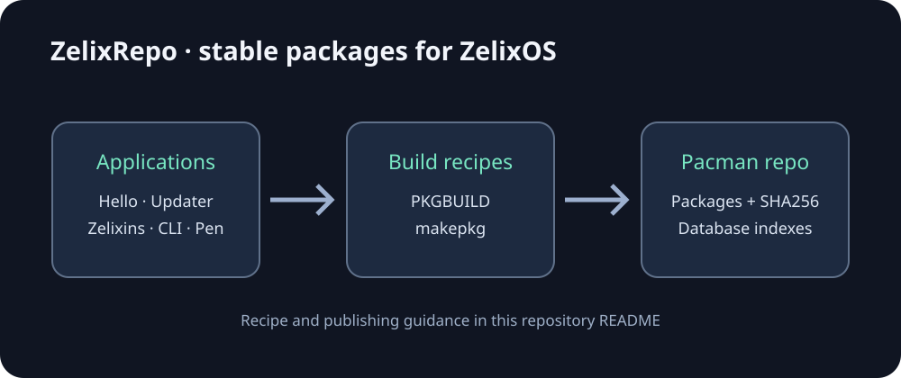

# ZelixOS Package Repository

This repository contains Arch package recipes (`PKGBUILD` files), packaging inputs for ZelixOS applications, and the pacman repository indexes used to distribute stable ZelixOS packages.



Application code lives in each application's source repository. This repository defines how that code is assembled into packages and how package files are indexed and published. Published package archives are attached to the [`stable` GitHub Release](https://github.com/ZelixOS/zelix-repo/releases/tag/stable), rather than committed as large binaries in the source tree.

## What is here

| Path | Purpose |
| --- | --- |
| `zelix-hello/` | Zelix Hello package recipe and packaging files |
| `zelix-updater/` | Zelix Updater package recipe and packaging files |
| `zelixins/` | Graphical installer package recipe and packaging files |
| `zelix-cli/` | Zelix CLI package recipe and command script |
| `zelixpen/` | ZelixPen package recipe and packaging files |
| `paru/`, `yay/` | AUR helper recipes used by the project |
| `x86_64/` | Repository database, file index, and tracked package metadata |
| `.github/workflows/` | Package publishing automation |

The repository index currently targets `x86_64`. Check an individual `PKGBUILD` for its `arch` field and dependencies.

## Enable ZelixRepo

ZelixOS images already include the ZelixRepo pacman entry. On another Arch-based installation, add the repository section to `/etc/pacman.conf`:

```ini
[zelixrepo]
SigLevel = Optional TrustAll
Server = https://github.com/ZelixOS/zelix-repo/releases/download/stable
```

This is the repository configuration used by the current ZelixOS profile. Refresh package databases and install applications with pacman:

```bash
sudo pacman -Syu zelix-hello zelix-updater zelix-cli zelixpen
```

Install the graphical installer only in the intended live/build environment:

```bash
sudo pacman -S zelixins
```

Review the package and dependency prompts before accepting. Find current binaries and repository indexes in the [stable release assets](https://github.com/ZelixOS/zelix-repo/releases/tag/stable).

## Build a package locally

Use Arch Linux or ZelixOS with `base-devel` and the dependencies listed by the selected recipe. Clone the repo, enter a package directory, and build as a regular user:

```bash
git clone https://github.com/ZelixOS/zelix-repo.git
cd zelix-repo/zelix-hello
makepkg -s
```

`makepkg -s` resolves declared dependencies using pacman and writes a package archive in the working directory. Do not run `makepkg` as root. To install a locally built package after reviewing it, use pacman from the directory containing the archive:

```bash
sudo pacman -U ./zelix-hello-*.pkg.tar.zst
```

In the ZelixOS development workspace, source files are synchronized from their main application repositories before packaging. Edit application code in its own repository and package metadata in the corresponding directory here; do not edit a generated packaging copy as the source of truth.

## Maintain package indexes

The `x86_64/` directory contains repository database/index files. A release publisher should:

1. Build each package from the intended source revision and inspect the package contents and version.
2. Generate and verify SHA-256 checksums for the package archives.
3. Use `repo-add` to generate the database and file indexes from exactly the packages being published.
4. Confirm each indexed archive exists in the release and that the checksum matches.
5. Upload the package archives and checksums, then publish matching `zelixrepo.db`, `zelixrepo.db.tar.gz`, `zelixrepo.files`, and `zelixrepo.files.tar.gz` assets to the stable release.
6. Refresh pacman databases and install or update packages from a clean test system.

The manually triggered **Publish Zelixins** GitHub Actions workflow builds and publishes the installer package. It does not publish every application package or replace the full repository release process.

## Troubleshooting

- **Pacman cannot find a Zelix package:** check the `[zelixrepo]` entry, the release server URL, internet access, and run `sudo pacman -Syy` to refresh databases.
- **A package has a missing dependency:** inspect its `depends`, `makedepends`, and `optdepends` fields; ensure Arch and ZelixRepo databases are current.
- **`makepkg` cannot find a source file:** initialize the source workspace and synchronize the application's packaging files before building.
- **The release database and assets disagree:** do not publish the index until every indexed package archive and checksum is present and verified.
- **A package is the wrong version:** compare the source revision, `pkgver`/`pkgrel`, generated archive name, and release assets before updating the repository database.

## Contributing

Keep package names, versions, dependencies, install paths, and source repositories aligned with each application. Include the target architecture, build command, package version, and error output in reports. Do not add package binaries or secrets to Git; use release assets for published archives and checksums.
